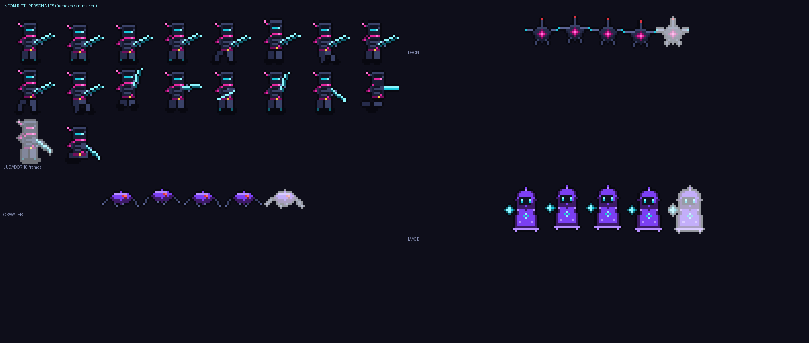
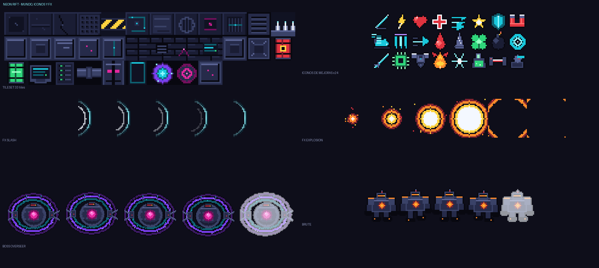
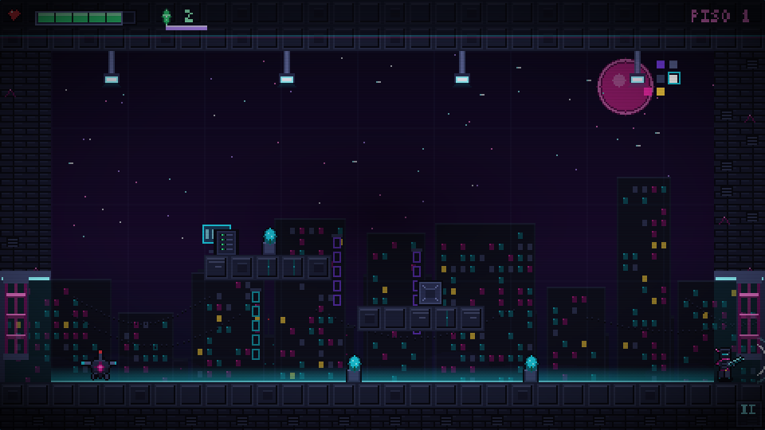
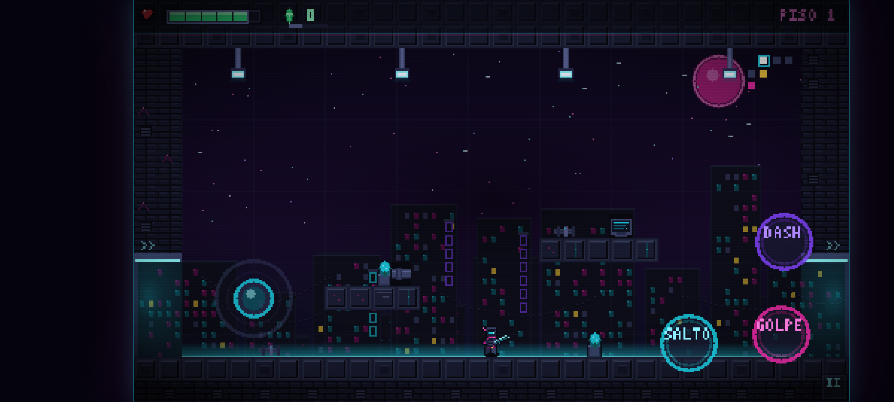
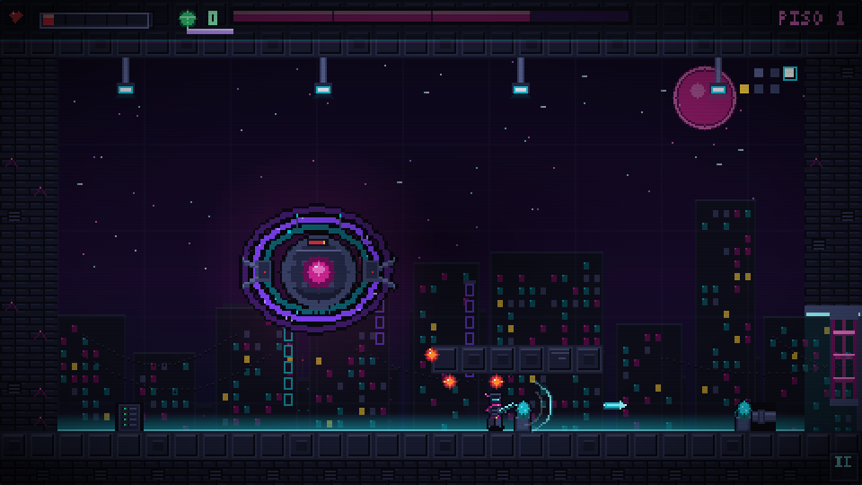

# Galería de arte — NEON RIFT

Todo el arte se genera por código con Python/Pillow. **Cero emoji, cero SVG.**

## Personajes

- **Jugador**: 18 frames — idle (4), run (6), jump, fall, attack (3), dash, hurt, death. 24×24 px, visor cian, bufanda magenta, espada de plasma.
- **Drone**: 4 frames + hurt. Enemigo volador con rotor y ojo magenta.
- **Crawler**: 4 frames + hurt. Arácnido robot violeta, salta.
- **Mage**: 4 frames + hurt. Cultista flotante con orbe de plasma.
- **Brute**: 4 frames + hurt. Tanque naranja con núcleo incandescente.

## Mundo, iconos y FX

- **Tileset**: 33 tiles (pisos, muros, puertas, props, portal).
- **24 iconos de mejoras**: espada, rayo, corazón, cruz, dash, estrella, escudo, imán, bota, triple, flecha, gota, espina, trébol, bomba, anillo, espada larga, chip, armadura, fénix, nieve, frasco, láser, torreta.
- **FX**: slash, explosión, impacto, dash trail, proyectil, orbe, onda de choque, spawn, escudo, portal, rayo.
- **Boss OVERSEER**: 64×64, anillos orbitales animados.

## Capturas del juego
| Escritorio | Móvil (Android) |
|---|---|
|  |  |

